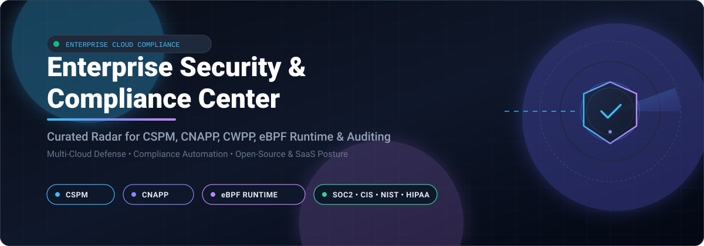

  

# 🛡️ Awesome Enterprise Security & Compliance Center 🚀

### *A Curated Directory of SaaS Platforms & Open-Source Projects for Multi-Cloud CSPM, CNAPP, CWPP, and Continuous Compliance Automation*

  
  
  
  
  
  
  

  <strong>Keywords:</strong> Cloud Security • Cloud Security Posture Management (CSPM) • Cloud-Native Application Protection Platform (CNAPP) • Cloud Workload Protection (CWPP) • Continuous Compliance • DevSecOps • eBPF Runtime Detection • SOC 2 • CIS Benchmarks • NIST • HIPAA • PCI-DSS • ISO 27001

---

## 📖 Overview

This repository is an authoritative, community-driven resource index tracking market-leading **commercial SaaS platforms** and powerful **open-source security tooling** designed for **Enterprise Security & Compliance Operations Centers**. 

As organizations scale their multi-cloud infrastructures across AWS, Microsoft Azure, Google Cloud Platform (GCP), and Kubernetes clusters, maintaining real-time visibility, automated posture governance, and audit readiness is critical. This guide provides actionable insights into pricing models, free-tier limitations, company market capitalization/valuations, and open-source alternatives to eliminate security blind spots and avoid vendor lock-in.

---

## 📑 Table of Contents
- [📊 Sector Overview & Market Dynamics](#-sector-overview--market-dynamics)
- [☁️ SaaS / Hosted Security Platforms](#️-saas--hosted-security-platforms)
- [🔓 Open-Source GitHub Projects](#-open-source-github-projects)
- [🤝 How to Contribute](#-how-to-contribute)
- [💖 Support](#-support)
- [📈 Star History](#-star-history)
- [⚠️ Disclaimer](#️-disclaimer)

---

## 📊 Sector Overview & Market Dynamics

The global **Cloud Security** market is projected to expand to **$43.8B – $46.2B in 2026** (delivering an ~11.5%–13.3% CAGR), spearheaded by the rapid acceleration of the **Cloud-Native Application Protection Platform (CNAPP)** market reaching **$12.6B – $17.8B** (at a >20% CAGR). 

Historically characterized as **moderately fragmented** by niche point tools across CSPM, CWPP, and CIEM, the ecosystem is rapidly undergoing intense **consolidation and concentration**. Driven by enterprise alert fatigue and complex multi-cloud architectures, the sector is centralizing into unified platform-centric oligopolies where deep identity-context graphs and code-to-cloud security workflows dominate.

---

## ☁️ SaaS / Hosted Security Platforms

| Product | Company Size / Valuation | Description | Pricing (Starting) | Free Tier / Trial Limits |
|---------|--------------------------|-------------|-------------------|--------------------------|
| **[Microsoft Defender for Cloud](https://azure.microsoft.com/en-us/products/defender-for-cloud/)** | ~$3.89 Trillion Market Cap (Microsoft) | 🌐 **Widest hybrid and multicloud coverage** (Azure, AWS, GCP, and on-premise via Azure Arc) with native posture and workload security. | Foundational CSPM: **$0.00**; Defender CSPM: **$5.00/server/month** | **Free Forever**: Foundational CSPM (continuous assessments & Secure Score across Azure/AWS/GCP); **30-Day Free Trial** per enhanced plan (AWS/GCP: 30 days per account). |
| **[Google Security Command Center](https://cloud.google.com/security-command-center)** | ~$3.50 Trillion Market Cap (Alphabet) | ⚡ **Best for Kubernetes-heavy GCP workloads**—specialized detection per workload type in Premium. Standard tier provides native posture visibility. | Standard Tier: **$0.00**; Premium Tier: Pay-as-you-go starting at **$0.0071/vCPU-hour** (Compute Engine, GKE) with **$15,000/year** subscription minimum | **Free Forever**: Standard tier includes asset discovery, sensitive data discovery, and vulnerability checks; **30-Day Free Trial** for Premium tier per project/organization. |
| **[AWS Security Hub](https://aws.amazon.com/security-hub/)** | ~$2.88 Trillion Market Cap (Amazon) | 🏗️ **Natural choice for AWS-heavy footprints**—centralizes findings from GuardDuty, Inspector, Macie, IAM Access Analyzer, and AWS Config. | First 10,000 ingested findings: **$0.00**; then **$0.00003 per finding event**; Security checks: **$0.0010 per check** | **Free Forever**: First 10,000 finding ingestion events/month free per account/Region; **30-Day Free Trial** with full access to checks and findings across accounts. |
| **[CrowdStrike Falcon Cloud Security](https://www.crowdstrike.com/)** | ~$240 Billion Market Cap (CrowdStrike) | 🦅 Unified agentless and agent-based cloud workload and posture protection extending Falcon detection to cloud compute, containers, and Kubernetes. | Flex License starting at **$233.99** (3-year contract per license via CDW) | **No Free Plan**; **15-Day Free Trial** (evaluates multi-cloud posture, workload protection, and container scanning; no credit card required). |
| **[Palo Alto Prisma Cloud](https://www.paloaltonetworks.com/prisma/cloud)** | ~$235 Billion Market Cap (Palo Alto Networks) | 🛡️ **Broadest toolset on paper** with mature compliance frameworks, custom policy support, CIEM, CSPM, and runtime CWPP. | Credit-based licensing starting at **$30,000/year** (minimum contract of 100 Prisma Cloud Credits; standard CSPM consumes 1 credit/instance) | **No Free Plan**; **30-Day Free Evaluation / Proof of Concept (PoC)** available via AWS Marketplace or direct sales. |
| **[Lacework FortiCNAPP](https://www.lacework.com/)** | ~$92 Billion Market Cap (Fortinet) | 🔍 **Mature behavioral detection via Polygraph** and native integration with the Fortinet security portfolio. | AWS Marketplace floor of **$25,000/12 months** (Standard tier covers up to 500 vCPUs; Pro covers 334 vCPUs) | **No Free Plan**; **30-Day Free Trial** available via AWS Marketplace covering posture assessment and cloud compliance policies. |
| **[Datadog Cloud Security](https://www.datadoghq.com/)** | ~$65 Billion Market Cap (Datadog) | 🐶 Unified security monitoring integrated into Datadog's observability platform—encompassing CSM Pro, Cloud Workload Security (CWS), and Cloud SIEM. | CSM Pro: **$120/host/year** (billed annually); CWS: **$180/host/year** | **No Free Plan for Security** (Free infra tier covers 5 hosts with 1-day metric retention, excluding security); **14-Day Free Trial** with full platform and security access. |
| **[Wiz](https://www.wiz.io/)** | ~$32 Billion Acquisition Valuation (Google) / $12B Private Valuation | 🧙 **Agentless CNAPP with the cleanest UI and fastest setup.** Uses a unified security graph to prioritize misconfigurations, exposed secrets, and attack paths. | Essential Tier starting at **$24,000/year** (covering 100 workloads); Advanced Tier starts at **$38,000/year** | **No Free Plan**; **30-Day Evaluation / Sandbox PoC** provided upon qualification through sales and AWS Marketplace. |
| **[Orca Security](https://orca.security/)** | ~$1.8 Billion Valuation (Unicorn) | 🐋 **Agentless side-scanning for fast, wide coverage from day one.** SideScanning technology reads block storage out-of-band to eliminate runtime agent performance overhead. | AWS Marketplace Small-Medium Tier starting at **$124,440/year** | **No Free Plan**; **30-Day Free Trial / Cloud Security Risk Assessment** via AWS Marketplace and direct demo. |

---

## 🔓 Open-Source GitHub Projects

Community-maintained, auditable, and self-hosted tools provide full data sovereignty, zero licensing overhead, and deep custom extensibility across cloud and container topologies.

| Project | Star Badge | Description |
|---------|------------|-------------|
| **[Trivy](https://github.com/aquasecurity/trivy)** |  | 🔍 The most widely adopted open-source vulnerability and misconfiguration scanner for containers, Kubernetes, code, and cloud. Scans vulnerabilities, SBOM, secrets, and IaC. |
| **[Prowler](https://github.com/prowler-cloud/prowler)** |  | 🐾 The leading open-source CSPM scanner for multi-cloud environments (AWS, Azure, GCP, Kubernetes, M365). 500+ checks mapped to CIS, NIST, PCI-DSS, GDPR, HIPAA, and SOC 2. |
| **[Kubescape](https://github.com/kubescape/kubescape)** |  | ☸️ CNCF open-source Kubernetes security platform covering posture, configuration risk analysis, compliance, vulnerability scanning, and RBAC visualizer. |
| **[Falco](https://github.com/falcosecurity/falco)** |  | 🦅 CNCF-graduated cloud-native runtime security for containers and Kubernetes. Uses eBPF-based kernel tracing to detect anomalous behavior, file writes, and process executions. |
| **[Checkov](https://github.com/bridgecrewio/checkov)** |  | 📋 Prevent cloud misconfigurations and compliance violations during build-time across Infrastructure as Code (Terraform, CloudFormation, Kubernetes, ARM, Bicep) and container images. |
| **[Steampipe](https://github.com/turbot/steampipe)** |  | ⚡ Zero-ETL open-source engine using SQL to query cloud infrastructure APIs (AWS, Azure, GCP, Kubernetes) for instant posture assessment, compliance checks, and inventory auditing. |
| **[Scout Suite](https://github.com/nccgroup/ScoutSuite)** |  | 🔭 Open-source multi-cloud security auditing tool for AWS, Azure, and GCP. Evaluates postures against security baselines and generates clear, comprehensive HTML audit reports. |
| **[Cloud Custodian](https://github.com/cloud-custodian/cloud-custodian)** |  | 📜 Rules engine for cloud security, posture management, governance, and cost optimization using a lightweight YAML DSL to query, filter, and remediate cloud resources. |
| **[ThreatMapper](https://github.com/deepfence/ThreatMapper)** |  | 🗺️ Open-source CNAPP platform providing vulnerability management, secret scanning, malware detection, and cloud security posture across multi-cloud, hosts, and Kubernetes clusters. |
| **[Terrascan](https://github.com/tenable/terrascan)** |  | 🏗️ Open-source static code analyzer for Infrastructure as Code (IaC) that detects compliance and security violations before provisioning cloud infrastructure. |
| **[Tetragon](https://github.com/cilium/tetragon)** |  | 🐝 eBPF-based security observability and runtime enforcement engine with in-kernel process blocking capabilities to stop threats before system calls complete. |
| **[OPA Gatekeeper](https://github.com/open-policy-agent/gatekeeper)** |  | 🐊 Policy controller for Kubernetes enforcing CRD-based policies and audit compliance checks via Open Policy Agent (OPA) directly at cluster admission. |
| **[CloudSploit](https://github.com/aquasecurity/cloudsploit)** |  | ☁️ Open-source cloud security posture management (CSPM) engine providing automated security, configuration, and compliance audits across AWS, Azure, GCP, Oracle, and GitHub. |

---

## 🤝 How to Contribute

Contributions are warmly welcomed! Help make this the most accurate and exhaustive directory for cloud security professionals:

1. 🍴 **Fork** the repository.
2. 🌿 **Create a branch** (`git checkout -b feature/new-security-tool`).
3. 📝 **Add or edit entries** in `README.md` keeping formatting clean and factual.
4. 🚀 **Commit and push** your changes (`git commit -m "Add tool XYZ"`).
5. 📬 **Submit a Pull Request** with a brief summary of the addition or correction.

---

## 💖 Support

If you found this resource helpful for your cloud security architecture, auditing, or compliance roadmap, please consider supporting the project:

- ⭐ **Star this repository** to improve visibility across the cybersecurity community!
- 🍴 **Fork and share** with fellow SecOps engineers and architects.
- ☕ **Sponsor or buy a coffee**: Support ongoing research and maintenance via the **[GitHub Sponsors Dashboard](https://github.com/sponsors/ishandutta2007)**!

---

## 📈 Star History

---

## ⚠️ Disclaimer

- This list is **community-curated** for educational, benchmarking, and architectural research purposes — not an explicit commercial endorsement.
- Enterprise security posture platforms demand deep read/audit permissions across cloud APIs and workload metadata; always follow the principle of least privilege (PoLP) when provisioning service principals and IAM roles.
- Pricing metrics, feature tiers, and licensing structures are subject to continuous vendor updates; verify directly with official product documentation or sales representatives prior to purchasing.

---

  Built with ❤️ for Cloud Security Architects, SOC Analysts, DevSecOps Engineers, and Compliance Teams.

